<h1 align="center">JUIGo</h1>

<p align="center">
  <strong>Interfaces desktop em Go, desenhadas pixel a pixel.</strong><br>
  Renderização por software, estado reativo tipado, formulários validados numa expressão<br>
  e testes de UI determinísticos — tudo atrás de um único <code>import</code>.
</p>

<p align="center">
  <a href="https://github.com/JonathanSantos/JUIGo/actions/workflows/testes.yml"></a>
  <a href="https://pkg.go.dev/github.com/JonathanSantos/JUIGo"></a>
  <a href="LICENSE"></a>
</p>

<p align="center">
  <a href="https://jonathansantos.github.io/JUIGo/"><strong>Documentação e componentes</strong></a> ·
  <a href="#começando">Começando</a> ·
  <a href="#componentes">Componentes</a> ·
  <a href="#exemplos">Exemplos</a> ·
  <a href="docs/API.md">Convenções da API</a>
</p>

<p align="center">
  <picture>
    <source media="(prefers-color-scheme: dark)" srcset="docs/vitrine-claude-escuro.png">
    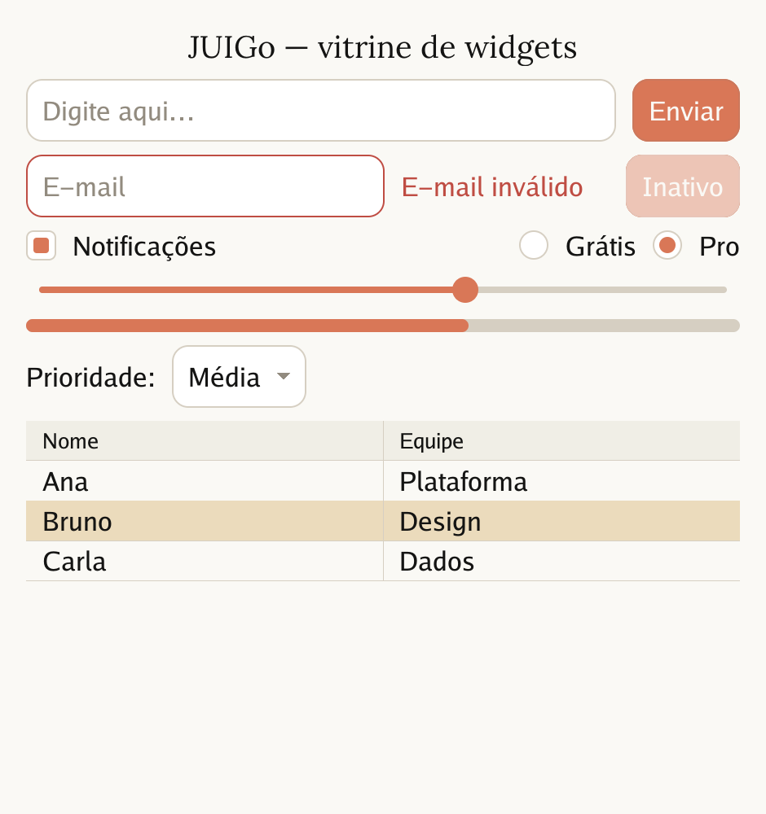
  </picture>
</p>

<p align="center"><sub>Nenhuma imagem desta página é mockup: todas são renderizadas pela própria lib,
offscreen (<a href="docs/gerar/main.go"><code>go run ./docs/gerar</code></a>). No modo escuro do GitHub
você vê as renderizações escuras.</sub></p>

> *JUIGo is a desktop GUI library for Go, built from scratch as a study
> project: software rendering, typed reactive state, a validated-forms
> layer and a deterministic UI-testing harness. The documentation is in
> Brazilian Portuguese.*

## Em números

| 25+ widgets | 15 µs | 0 | 3 |
| :---: | :---: | :---: | :---: |
| de Button a CodeEditor, Tree e Table | por frame incremental | alocações no caminho quente | dependências (GLFW, GL, `x/image`) |

## Começando

**Requisitos:** Go 1.26+ e uma toolchain C (o GLFW compila via cgo), com os
headers de janela/GL da sua plataforma:

| Plataforma | O que instalar |
| --- | --- |
| macOS | Xcode Command Line Tools (`xcode-select --install`) |
| Linux | `libgl1-mesa-dev libx11-dev libxrandr-dev libxi-dev libxcursor-dev libxinerama-dev` |
| Windows | toolchain gcc (MSYS2 ou TDM-GCC) |

```bash
go get github.com/JonathanSantos/JUIGo
```

```go
package main

import (
	"log"

	juigo "github.com/JonathanSantos/JUIGo"
)

func main() {
	nome := juigo.NewState("mundo")
	ui := juigo.NewVBox(
		juigo.NewText("").BindText(juigo.Map(nome, func(s string) string {
			return "Olá, " + s + "!"
		})).Center(),
		juigo.NewInput("Seu nome…").BindValue(nome),
	).Pad(16)

	if err := juigo.Run("Olá, JUIGo", 360, 140, ui); err != nil {
		log.Fatal(err)
	}
}
```

Digite no campo e o título reage a cada tecla — o `State` é a única fonte
de verdade e a interface é uma projeção dele. A fonte **Go Regular**
([go.dev/blog/go-fonts](https://go.dev/blog/go-fonts), licença BSD do
projeto Go) vem embutida via `go:embed`: binários JUIGo não dependem de
fontes do sistema.

## Componentes

Cada captura abaixo tem o código que a gerou no
[site da documentação](https://jonathansantos.github.io/JUIGo/#componentes).

<table>
  <tr>
    <td width="50%" valign="top">
      <a href="https://jonathansantos.github.io/JUIGo/#c-botoes"><b>Button</b></a><br>
      <picture><source media="(prefers-color-scheme: dark)" srcset="docs/componentes/botoes-escuro.png">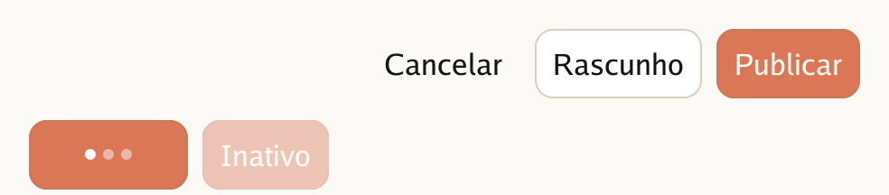</picture>
    </td>
    <td width="50%" valign="top">
      <a href="https://jonathansantos.github.io/JUIGo/#c-entradas"><b>Input e TextArea</b></a><br>
      <picture><source media="(prefers-color-scheme: dark)" srcset="docs/componentes/entradas-escuro.png">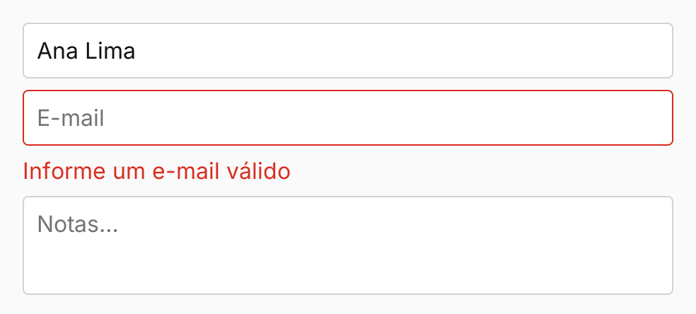</picture>
    </td>
  </tr>
  <tr>
    <td valign="top">
      <a href="https://jonathansantos.github.io/JUIGo/#c-escolhas"><b>Checkbox, Radio e Dropdown</b></a><br>
      <picture><source media="(prefers-color-scheme: dark)" srcset="docs/componentes/escolhas-escuro.png">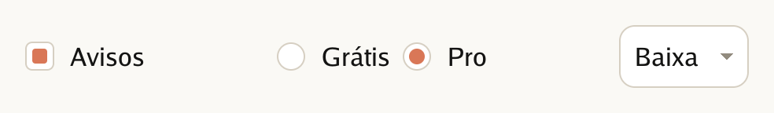</picture>
      <br><br>
      <a href="https://jonathansantos.github.io/JUIGo/#c-slider"><b>Slider e ProgressBar</b></a><br>
      <picture><source media="(prefers-color-scheme: dark)" srcset="docs/componentes/slider-escuro.png">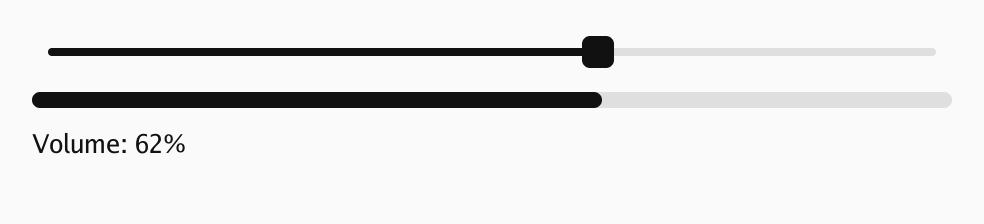</picture>
    </td>
    <td valign="top">
      <a href="https://jonathansantos.github.io/JUIGo/#c-formulario"><b>quick.Form</b></a><br>
      <picture><source media="(prefers-color-scheme: dark)" srcset="docs/componentes/formulario-escuro.png">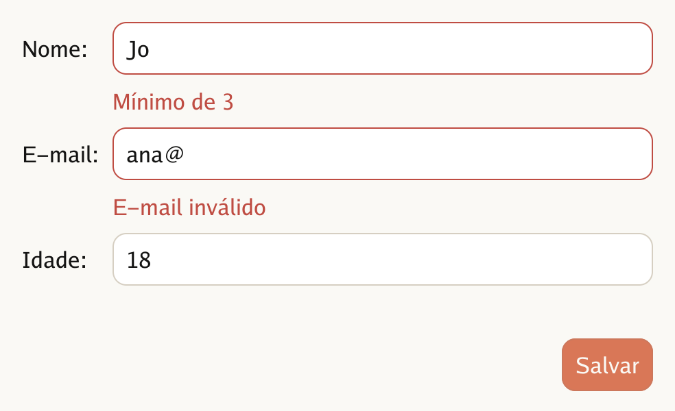</picture>
    </td>
  </tr>
  <tr>
    <td valign="top">
      <a href="https://jonathansantos.github.io/JUIGo/#c-tabela"><b>Table</b></a><br>
      <picture><source media="(prefers-color-scheme: dark)" srcset="docs/componentes/tabela-escuro.png">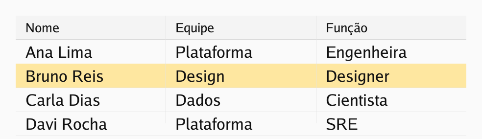</picture>
    </td>
    <td valign="top">
      <a href="https://jonathansantos.github.io/JUIGo/#c-editor"><b>CodeEditor</b></a><br>
      <picture><source media="(prefers-color-scheme: dark)" srcset="docs/componentes/editor-escuro.png">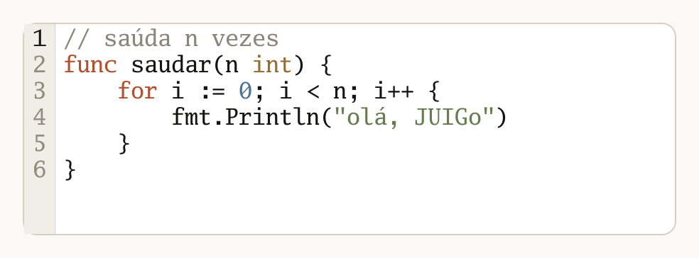</picture>
    </td>
  </tr>
  <tr>
    <td valign="top">
      <a href="https://jonathansantos.github.io/JUIGo/#c-graficos"><b>chart</b></a><br>
      <picture><source media="(prefers-color-scheme: dark)" srcset="docs/componentes/graficos-escuro.png">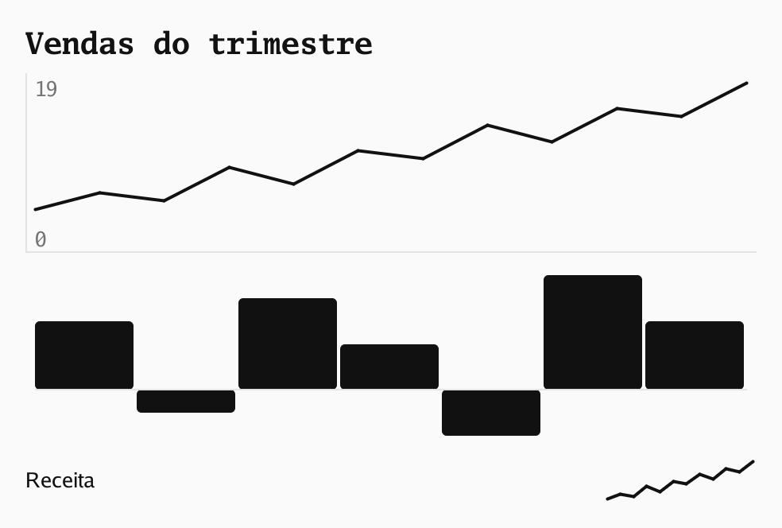</picture>
    </td>
    <td valign="top">
      <a href="https://jonathansantos.github.io/JUIGo/#c-calendario"><b>Calendar</b></a><br>
      <picture><source media="(prefers-color-scheme: dark)" srcset="docs/componentes/calendario-escuro.png">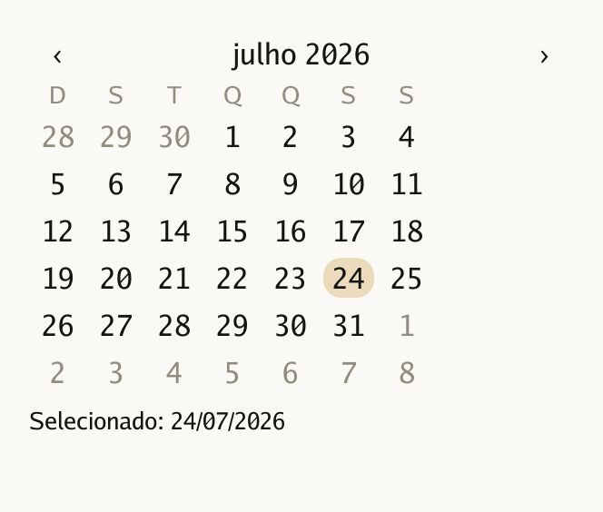</picture>
      <br><br>
      <a href="https://jonathansantos.github.io/JUIGo/#c-arvore"><b>Tree</b></a><br>
      <picture><source media="(prefers-color-scheme: dark)" srcset="docs/componentes/arvore-escuro.png">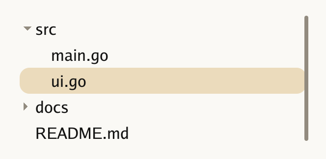</picture>
    </td>
  </tr>
</table>

E ainda: Text e Label (parágrafo com quebra de linha e papéis
tipográficos), List virtualizada, Tabs, SplitPane, Card, Divider, Image,
Grid, Scroll, Modal, Popup ancorado, Tooltip, MenuBar e Navigator.

## O que vem na caixa

| | |
| --- | --- |
| **Reatividade tipada** | `State[T]` + `Map`/`Combine`, bindings de duas vias (`BindValue`, `BindChecked`, `BindSelected`, `BindDisabled`, `BindInvalid`) com referência fraca — nada vaza. |
| **Tudo inline** | Opções e callbacks são métodos encadeáveis que devolvem o tipo concreto: `NewInput("E-mail").BindValue(mail).OnSubmit(enviar).Grow(1)`. |
| **Formulários em uma expressão** | `quick.Form` com handles tipados, validação e erros por campo; `Confirm`/`Alert`/`Prompt`, `Menu`, `Toast` e seletor de arquivos 100% JUIGo. |
| **Navegação** | `Navigator` com pilha de telas e transições animadas (deslizar nas quatro direções e fade); telas dormentes preservam o estado. |
| **Comandos e paleta** | `Command{Título, atalho, ação}`, `MenuBar` cujos itens são comandos e a paleta **Ctrl/Cmd+K** embutida. |
| **Tema ambiente** | Construtores não pedem tema; `DefaultTheme`, `DarkTheme` e o design system papel e tinta, trocáveis em runtime. HiDPI transparente. |
| **Testável de verdade** | `uitest` dirige o MESMO núcleo do App real, headless, com relógio virtual e screenshots determinísticos. |
| **Rápida por construção** | Dirty regions, zero alocações no caminho quente; um golden test prova que o frame incremental é byte a byte igual ao completo. |
| **E mais** | Múltiplas janelas, drag-and-drop, undo/redo (`History`), timers, animações (`anim.Tween`), `App.Post` para goroutines, textos da lib em inglês ou pt-BR (`SetLocale`) e inspector de depuração (**Ctrl/Cmd+I**). |

## Design system "papel e tinta"

<table>
  <tr>
    <td>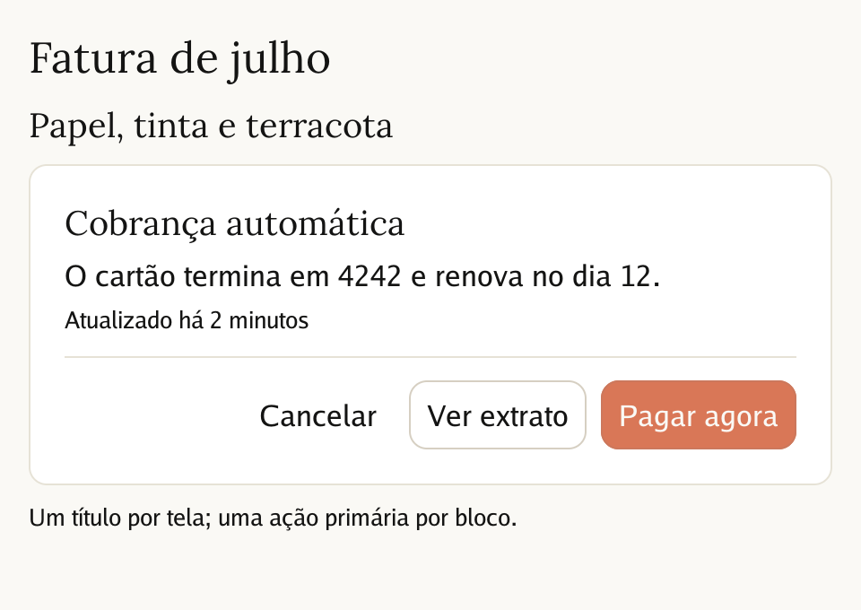</td>
    <td>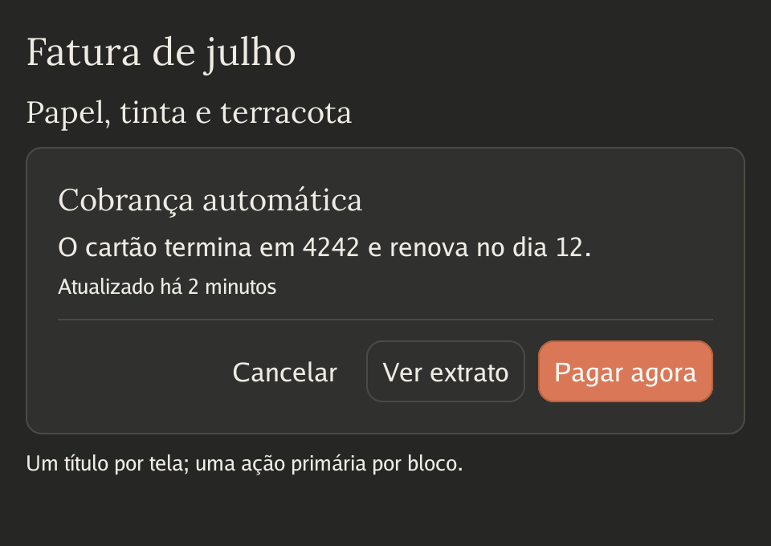</td>
  </tr>
</table>

Uma identidade completa pronta para usar, inspirada na linguagem visual do
Claude (Anthropic): papel e tinta como base, títulos na serif Lora
(embutida, OFL), terracota exclusiva para ações e neutros quentes. Vem com
papéis tipográficos (`Title/Subtitle/Caption`), hierarquia de botões
(`Secondary`/`Ghost`), superfícies (`Card`, `Divider`) e movimento.
`juigo.ClaudeTheme()` e `juigo.ClaudeDarkTheme()` compartilham as métricas
e alternam em runtime sem a interface pular. Tokens e regras em
[docs/DESIGN.md](docs/DESIGN.md).

<details>
<summary><b>Os temas clássicos</b> — <code>DefaultTheme</code> e <code>DarkTheme</code></summary>
<br>

| Tema claro | Tema escuro |
| --- | --- |
| 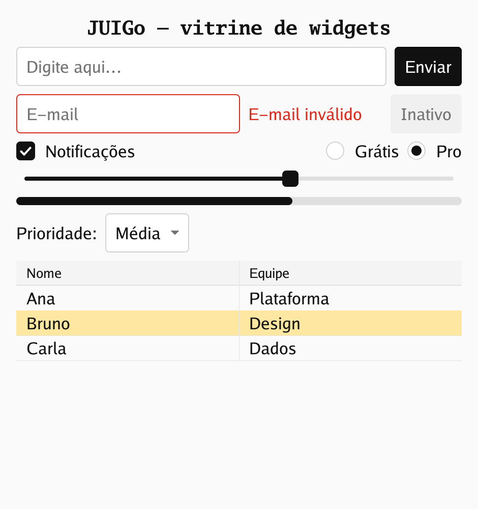 | 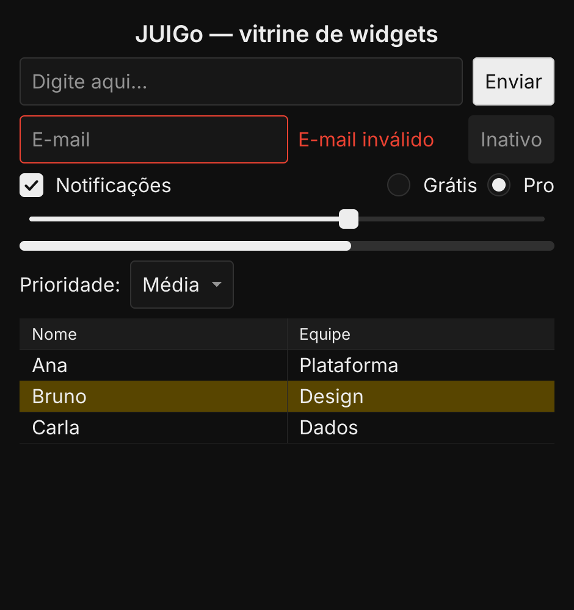 |

Todos com cantos arredondados com antialiasing (`Theme.Radius`, padrão 4);
`ClassicTheme` (ou `Radius = 0`) devolve o visual reto, pixel a pixel.
</details>

## Como se usa

<details open>
<summary><b>Formulários com <code>quick</code></b></summary>
<br>

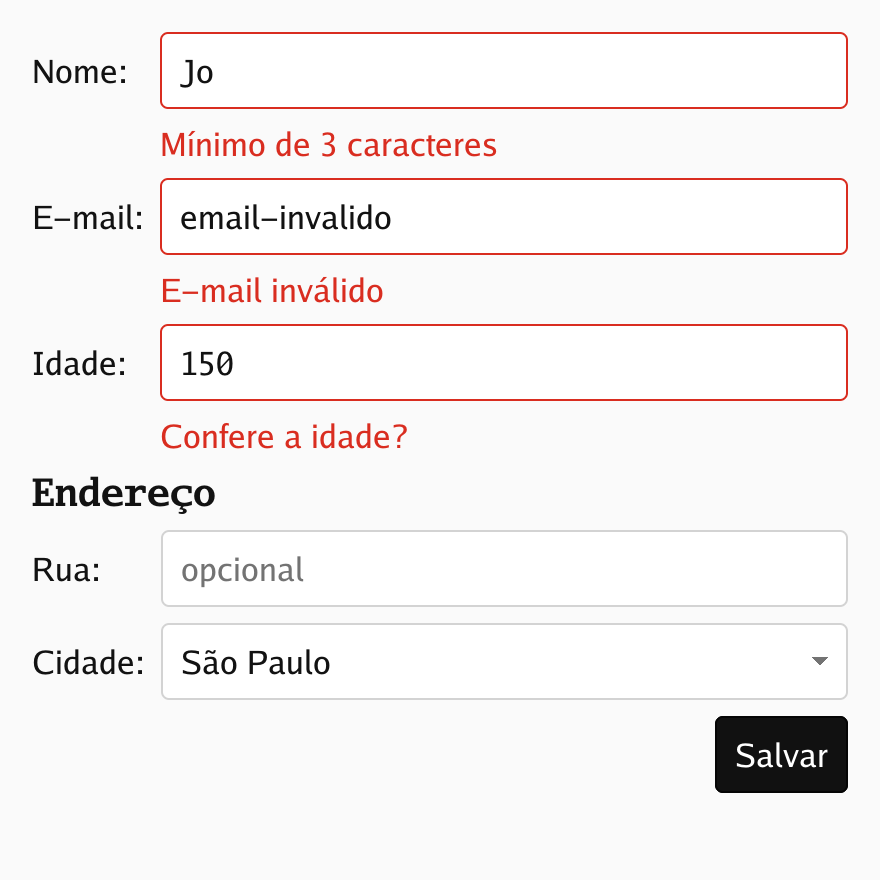

```go
nome  := quick.Text("Nome:").Required("Informe o nome").Min(3, "Mínimo de 3")
email := quick.Text("E-mail:").Email("E-mail inválido")
idade := quick.Number("Idade:", 18).Max(120, "Confere a idade?")

quick.Form(nome, email, idade).Submit("Salvar", func() {
    salvar(nome.Value(), email.Value(), idade.Value()) // string, string, int
})
```

Cada campo é um **handle tipado** dono do próprio State — a variável é a
"chave" do formulário, verificada pelo compilador. Erros aparecem por campo
(no blur ou no envio), Enter envia e `Section` divide formulários longos. A
regra da rampa: tudo aceita e devolve widgets comuns — quando o padrão
pronto não servir, desça um nível naquele ponto sem reescrever a tela.
<br clear="right">
</details>

<details>
<summary><b>Navegação entre telas</b></summary>
<br>

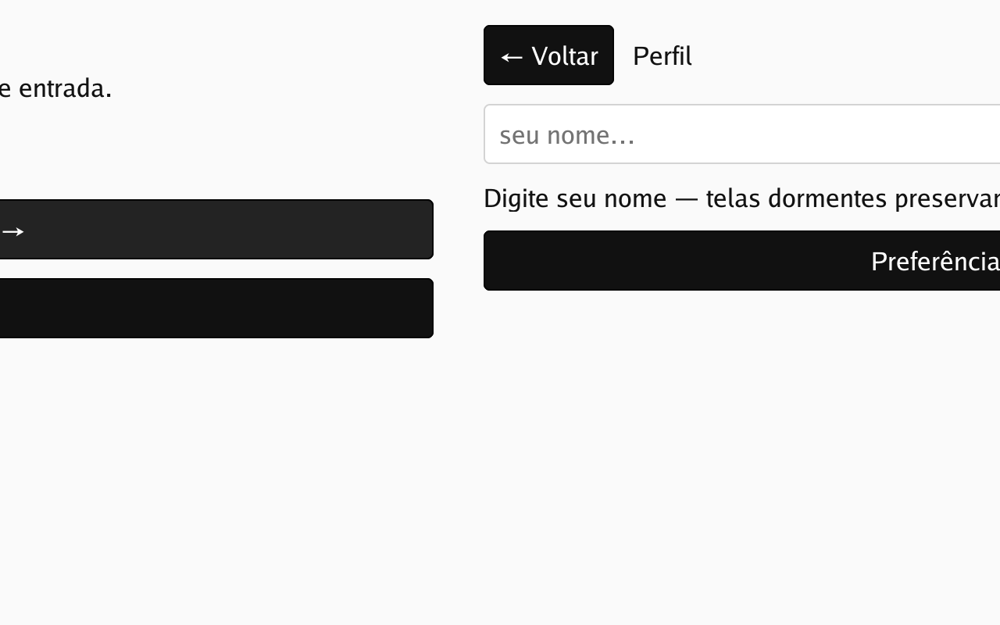

```go
nav := juigo.NewNavigator()
nav.Push(telaInicial(nav))
juigo.Run("App", 800, 600, nav)

// nos botões das telas:
nav.Push(telaDetalhes(nav))                       // desliza da direita
nav.Push(telaAjuda(nav), juigo.TransitionSlideUp) // sobe como uma folha
nav.Pop()                                         // reverte a transição de entrada
```

O `Navigator` é um widget comum: sirva-o de raiz, aninhe-o numa aba, o que
for. Só a tela do topo participa de eventos e foco; as demais dormem na
pilha com o estado intacto. A duração vem do tema
(`Theme.TransitionDuration`) e, no `uitest`, `Advance` atravessa uma
transição deterministicamente, quadro a quadro.
</details>

<details>
<summary><b>Testando sua aplicação com <code>uitest</code></b></summary>
<br>

```go
func TestFormulario(t *testing.T) {
	h := uitest.New(t, ui, 480, 240)
	h.Click(uitest.Placeholder("Digite…")) // foca de verdade
	h.Type("olá, ação")                    // runes, com acentos
	h.Hover(uitest.Text("Enviar"))
	h.Advance(600 * time.Millisecond)      // relógio virtual: tooltip aparece
	img := h.Screenshot()                  // determinístico → golden tests
}
```

Seletores por texto, placeholder, tipo (`OfType[*juigo.Button]()`) e
predicado; `Advance` dispara timers, animações e piscada de cursor na
ordem, sem dormir.
</details>

<details>
<summary><b>As ideias que sustentam a DX</b></summary>
<br>

- **Uma API, uma regra** — propriedade é `X()`/`SetX(v)`, opção é verbo sem
  `Set`, `OnChange` sempre entrega o valor e só reage ao usuário, todo
  `Bind*` tem o seu par de leitura. Convenções em [docs/API.md](docs/API.md);
  quem vem de uma versão anterior segue
  [docs/MIGRACAO-v0.19.md](docs/MIGRACAO-v0.19.md).
- **Layout sem cerimônia** — `VBox`/`HBox` com `.Grow(peso)`, `Spacer`,
  `.Centered()`/`.AtStart()`/`.AtEnd()`; `Grid(n, …)` para formulários
  alinhados; `Scroll` (com `ScrollToEnd` e `StickToEnd` para chats e logs)
  e `List`/`Table` virtualizadas — `NewTextList` quando a linha é só texto.
- **Disabled e loading centrais** — `.BindDisabled(estado)` tira o widget
  (e a subárvore) da interação; `Button.BindLoading` mostra spinner.
- **Trabalho assíncrono com `App.Post`** — o único método thread-safe:
  goroutine trabalha, `Post` entrega o resultado à main thread.
- **Undo, timers e seleção** — `NewHistory` (com `CanUndo`/`CanRedo`
  prontos para botões), `After`/`Every` no relógio da aplicação e
  `BindSelected` fazendo da linha selecionada um State qualquer.
</details>

## Exemplos

<table>
  <tr>
    <td colspan="2">
      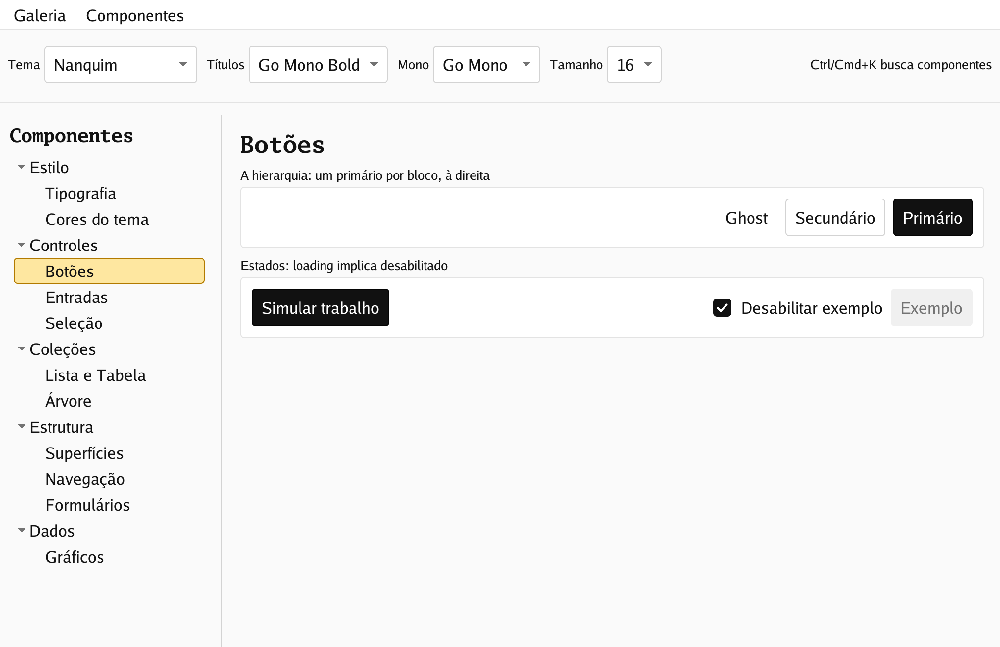<br>
      <b><code>go run ./examples/galeria</code></b> — o <b>storybook</b> do JUIGo, feito com o próprio JUIGo:
      a árvore lateral navega pelos componentes e a barra do topo troca tema, fontes e tamanho de texto em pleno voo.
      Ctrl/Cmd+K busca componentes.
    </td>
  </tr>
  <tr>
    <td colspan="2">
      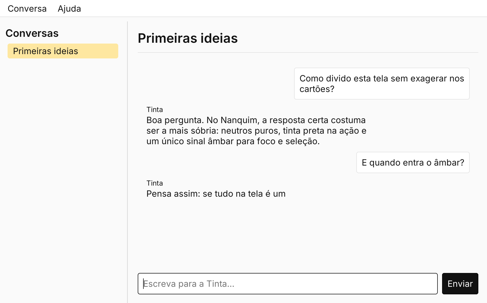<br>
      <b><code>go run ./examples/chat</code></b> — a demo bandeira do design system: <code>SplitPane</code>,
      balões de <code>Card</code> com <code>Label</code>, barra de menus com atalhos e a resposta chegando "digitando".
    </td>
  </tr>
  <tr>
    <td width="50%" valign="top">
      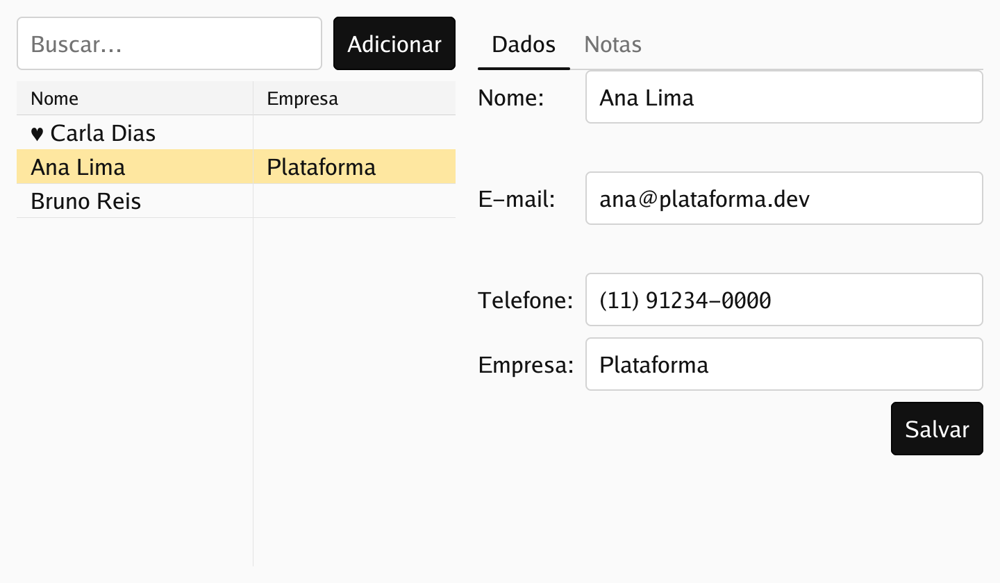<br>
      <b><code>examples/contatos</code></b> — mestre-detalhe: busca, tabela, abas, menu de contexto, exclusão com confirmação e toasts.
    </td>
    <td width="50%" valign="top">
      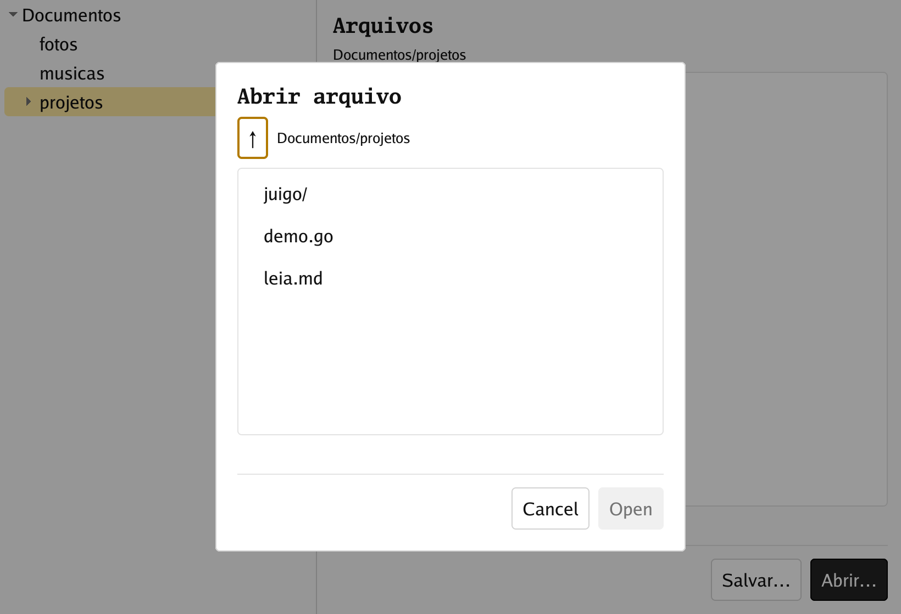<br>
      <b><code>examples/arquivos</code></b> — <code>SplitPane</code>, <code>Tree</code> de pastas lida sob demanda e o seletor <code>quick.OpenFile</code>/<code>SaveFile</code>.
    </td>
  </tr>
  <tr>
    <td valign="top">
      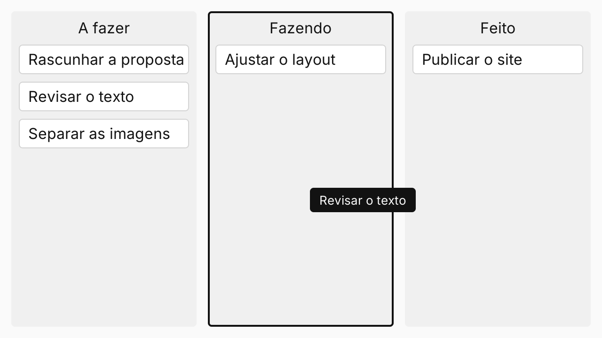<br>
      <b><code>examples/kanban</code></b> — drag-and-drop entre colunas, com fantasma, realce do alvo e cancelamento no Escape.
    </td>
    <td valign="top">
      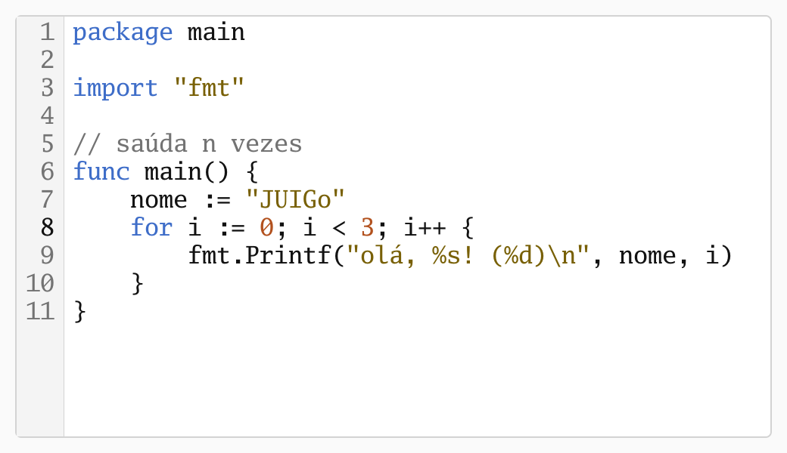<br>
      <b><code>examples/editor</code></b> — highlight incremental, auto-indentação, par de parênteses, undo coalescido e Go Mono ↔ Fira Code.
    </td>
  </tr>
  <tr>
    <td valign="top">
      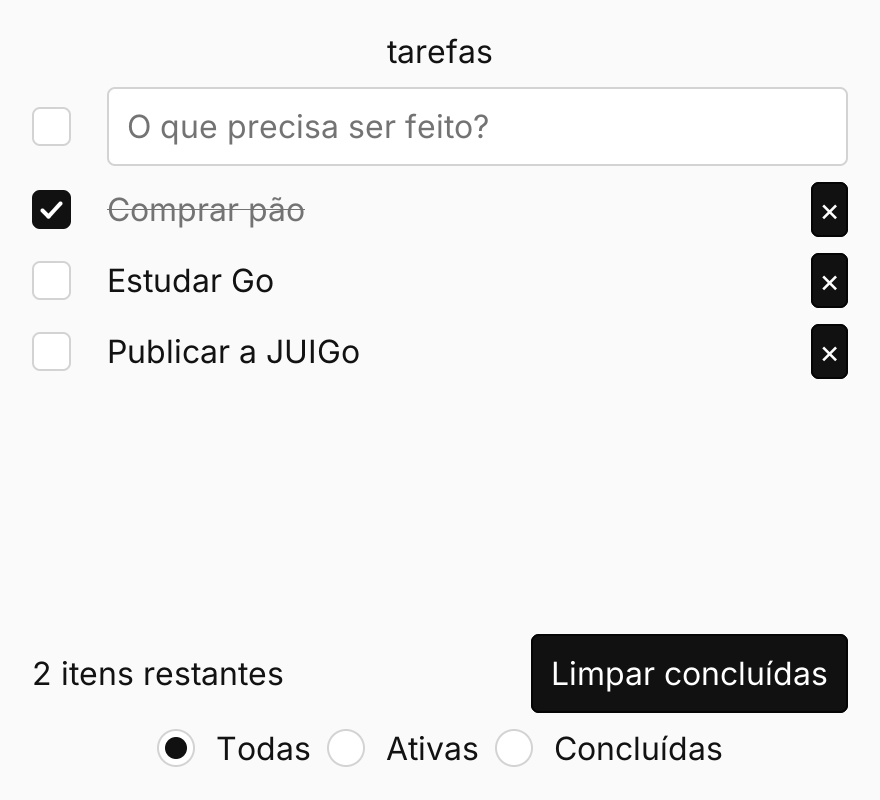<br>
      <b><code>examples/todo</code></b> — TodoMVC em três camadas, com persistência JSON e edição inline.
    </td>
    <td valign="top">
      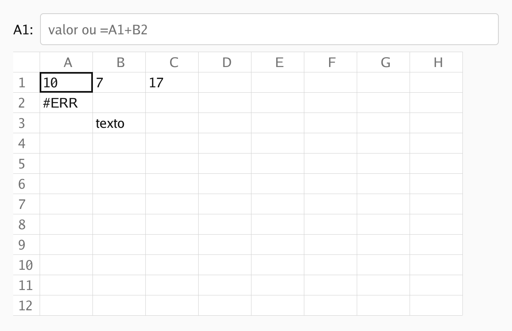<br>
      <b><code>examples/7guis</code></b> — o <a href="https://eugenkiss.github.io/7guis/">7GUIs</a> completo, cada tarefa com testes
      (<a href="examples/7guis/GAPS.md">o que o exercício rendeu à lib</a>).
    </td>
  </tr>
  <tr>
    <td colspan="2">
      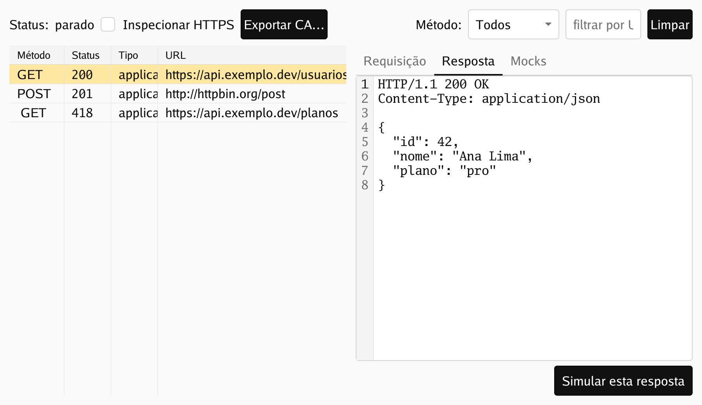<br>
      <b><code>go run ./examples/proxy</code></b> — um mini proxy de depuração HTTP/HTTPS local: captura, filtra,
      mostra requisição e resposta em <code>CodeEditor</code> <code>ReadOnly</code> e simula respostas (mocks).
    </td>
  </tr>
</table>

> **Segurança do proxy:** para inspecionar HTTPS ele gera uma CA local
> (MITM, a técnica do mitmproxy/Charles). A CA nasce e vive só na sua
> máquina (chave `0600`), nunca deve ser compartilhada, e a inspeção só se
> justifica para depurar o **seu próprio** tráfego. Cert pinning continua
> rejeitando o proxy. Ele escuta só em `127.0.0.1` — expor na rede
> (`-addr :8080`) o transforma num relay aberto para quem estiver no mesmo
> wifi. É um proxy **explícito**: captura o que for apontado para ele
> (`HTTPS_PROXY=http://localhost:8080 curl https://httpbin.org/get`), não o
> tráfego inteiro da máquina.

Também no repositório: **`basic`** (bindings, modal, tema escuro ao vivo,
lista de 500 itens e `Post`), **`navegacao`** (três níveis de telas com
transições) e **`janelas`** (`App.NewWindow`, tema por janela e o MESMO
`State` reagindo em todas).

Testes de tudo, sem abrir janela:

```bash
go test ./...
```

## Por dentro

| | |
| --- | ---: |
| Frame completo numa retina 13" inteira (2560×1600) | **0,55 ms** de CPU (3% do orçamento de 60 Hz) |
| Frame incremental (dirty regions) | **15 µs** |
| Rolagem numa List de 10.000 linhas | **40 µs** |
| Alocações no caminho quente de desenho | **zero** — provado por `AllocsPerRun` |
| Binário completo, `-s -w` | **3,7 MB** (1,1 MB são as cinco fontes embutidas) |

Medições, metodologia e a análise honesta de viabilidade — incluindo o que
a lib ainda **não** faz — em [docs/BENCHMARK.md](docs/BENCHMARK.md). A
organização de pacotes e os contratos (Widget, roteamento, overlay, tema)
em [docs/ARQUITETURA.md](docs/ARQUITETURA.md).

<details>
<summary><b>A filosofia</b></summary>
<br>

- **Desenho 100% por software.** Cada pixel nasce num `*image.RGBA`; o
  OpenGL só apresenta o buffer. Isso compra determinismo (o mesmo código
  produz os mesmos bytes — a base dos golden tests e das screenshots desta
  página), renderização offscreen sem janela e uma fronteira de plataforma
  minúscula: se o macOS aposentar o OpenGL de vez, troca-se só o blitter.
- **Zero alocação no caminho quente é regra com polícia**, não aspiração:
  benchmarks de allocs fazem parte da suíte. O relatório de benchmark
  flagrou o widget mais novo alocando 2× por frame (method values virando
  closures) — a correção saiu no mesmo commit do relatório.
- **Single-threaded por contrato.** Uma thread, um loop dirigido a eventos,
  `App.Post` como única porta de entrada para goroutines. Sem mutex em
  widget, sem corrida para debugar.
- **Três dependências, e nada mais.** GLFW, GL e `x/image`. Até as fontes
  vêm embutidas — um `go build` produz um binário que não pede nada ao
  sistema.
- **Erros sem pânico, godoc em português, um commit por incremento
  compilável.** Convenções pequenas que aguentaram a lib triplicar de
  tamanho sem apodrecer.
</details>

<details>
<summary><b>A obsessão com DX</b></summary>
<br>

Quase toda API nasceu de uma dor concreta, não de um plano: o tema ambiente
existe porque passar `theme` em todo construtor doía; os handles tipados do
`quick.Form` existem porque `Get("nome")` por string é bug esperando hora;
**a variável é a chave** virou princípio — o compilador confere o que, em
outras libs, é convenção de string. E a regra da rampa atravessa tudo: as
camadas altas (`quick`) aceitam e devolvem widgets comuns, então quando o
pronto não serve, desce-se UM degrau naquele ponto — nunca reescrever a
tela.
</details>

<details>
<summary><b>uitest, a aposta que mais pagou</b></summary>
<br>

O núcleo de interação inteiro (roteamento, foco, overlay, captura, relógio)
vive numa `Session` sem janela; o App real é uma casca GLFW por cima, e o
[uitest](uitest) dirige a MESMA Session nos testes. O retorno composto
disso: o golden test "frame incremental == frame completo" pegou bugs reais
de dano em três widgets diferentes antes de qualquer usuário; e quando a
altura de TODAS as linhas de TODAS as listas mudou (design system),
**nenhum teste quebrou** — eles testam comportamento, não pixels decorados.
</details>

<details>
<summary><b>Curiosidades</b></summary>
<br>

- **19.585 linhas de biblioteca**, cobertas por **7.893 linhas de testes**
  (234 testes, ~10 s de suíte) e demonstradas por **6.071 linhas de
  exemplos** — 11 apps, incluindo o 7GUIs completo, um mini-proxy que
  inspeciona HTTPS e um chat.
- Do primeiro commit à `v0.17.0` foram **três dias** (22–24/jul/2026) e
  116 commits — nenhum deles quebrando a suíte.
- Dos ~101 MB de RSS de um app rodando, **88 MB são a stack OpenGL da
  Apple**; a interface em si vive em dígitos únicos de MB.
- A fonte Go Regular não cobre ★ nem ◀, mas cobre ♥ ← ↑ ‹ › — o exemplo de
  contatos usa ♥ nos favoritos por isso, e foi um teste de `GlyphAdvance`
  que decidiu.
- O bug mais sutil até hoje: `draw.Over` exige cor pré-multiplicada — os
  contornos verdes do inspector é que denunciaram.
</details>

## Status

Projeto de **estudo**, em evolução ativa. Versionado por tags `v0.x` — na
série 0.x a API ainda quebra entre versões, sem janela de depreciação.
Desenvolvido e verificado no macOS; Linux e Windows têm as dependências
mapeadas, mas ainda não foram testados. Issues e correções são bem-vindas.

**Fora de escopo (por enquanto):** acessibilidade, IME (composição de texto
asiático — avaliação e plano em [docs/IME.md](docs/IME.md)) e edição rica
(negrito/itálico). A arquitetura foi pensada para recebê-los depois:
eventos são tipos abertos, o tema é injetado, containers são aninháveis e o
desenho é isolado em `render/`.

## Licença

[MIT](LICENSE). A fonte Go Regular embutida segue a
[licença BSD do projeto Go](https://go.dev/LICENSE); Lora e Fira Code, a
OFL (textos em [`theme/assets`](theme/assets)).
