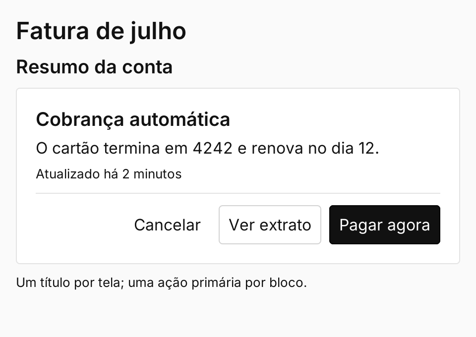
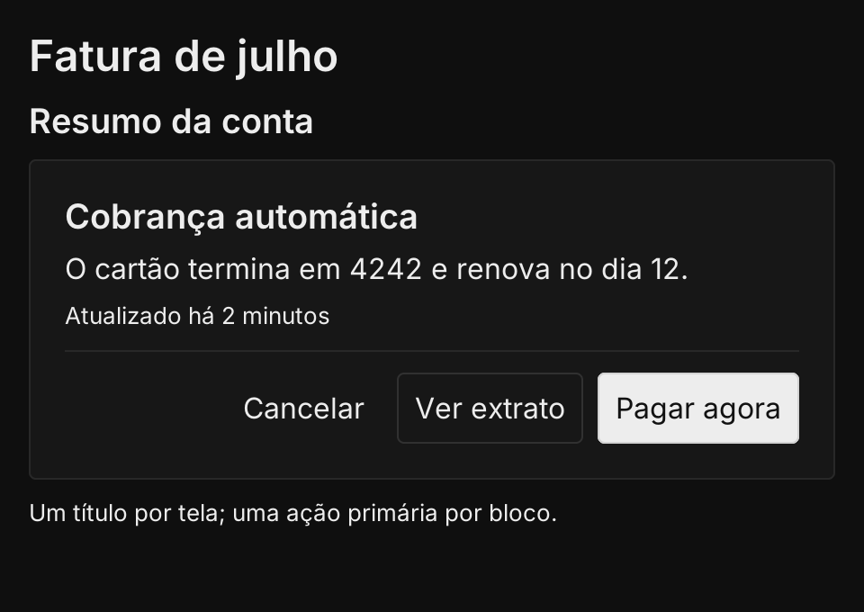
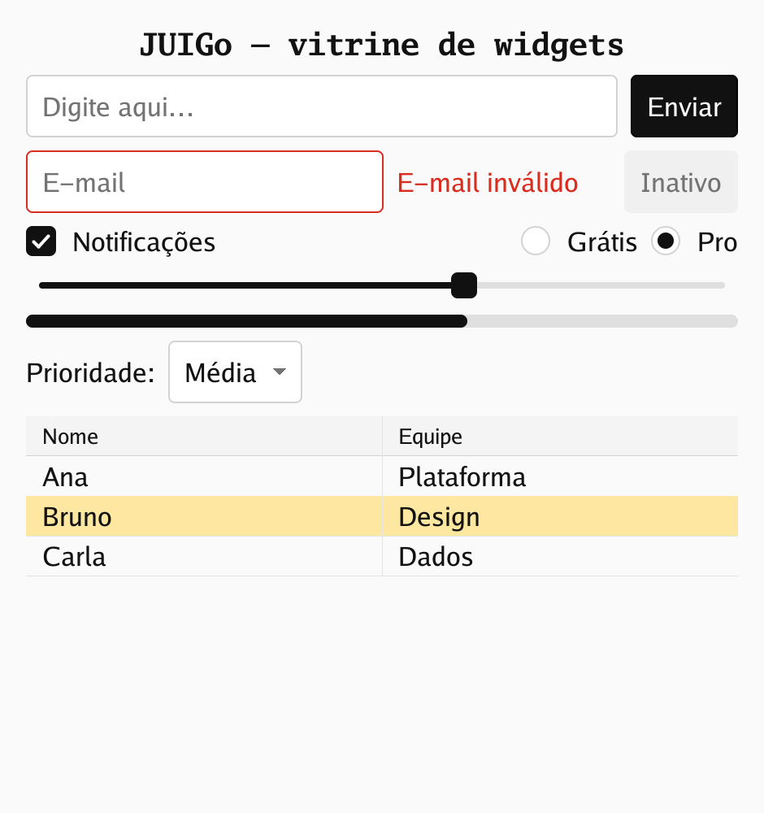
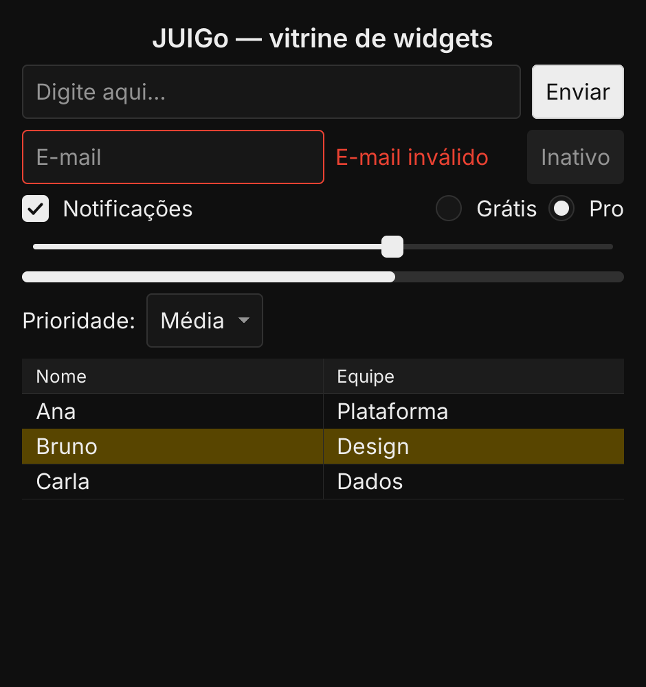
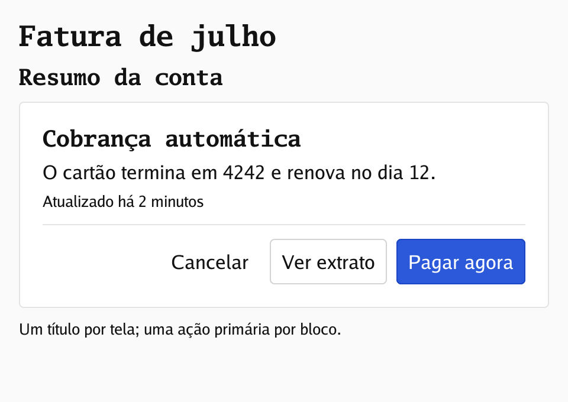
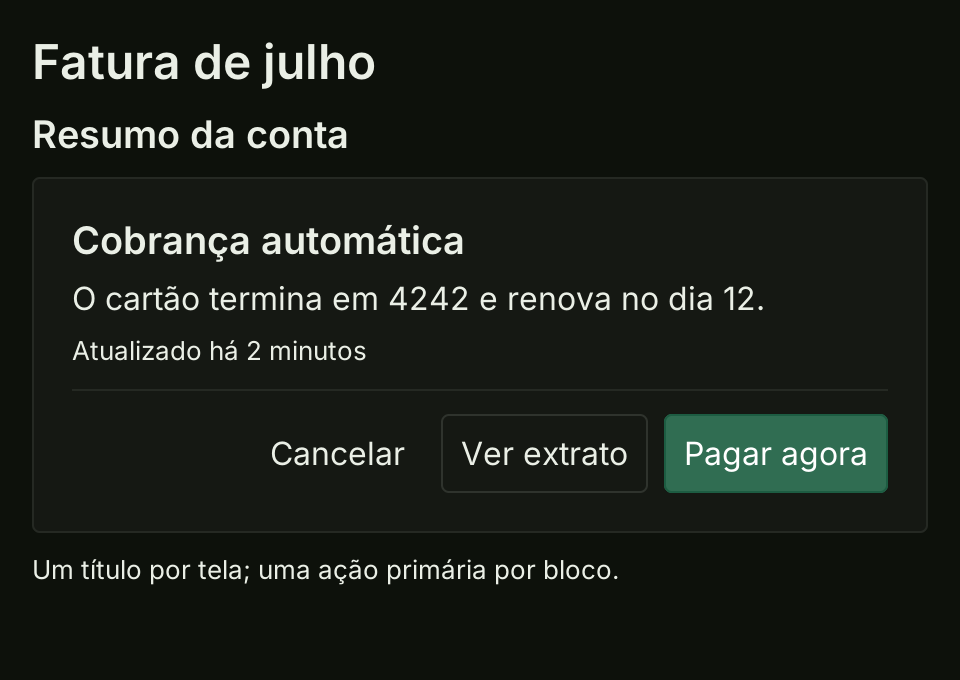

# Design system Nanquim

A identidade visual do JUIGo. Tinta preta sobre neutros puros, um único
sinal âmbar e títulos em Go Mono Bold: cara de ferramenta, nada de
decoração. É o tema padrão: `juigo.Run` já abre com ele, sem configurar
nada.

| Claro | Escuro |
| --- | --- |
|  |  |
|  |  |

```go
claro, _ := juigo.DefaultTheme() // o mesmo que vem sem configurar
escuro, _ := juigo.DarkTheme()   // mesmas métricas: a troca não move layout

app.SetTheme(escuro)
```

## Princípios

1. **Tinta é ação.** O botão primário, a marca do checkbox e do radio, o
   trilho ativo do slider e a aba ativa são tinta (`#111111`). No escuro a
   tinta se inverte e vira a cor do texto (`#EDEDED`), com rótulo escuro.
   Se algo não é ação nem estado ativo, não é tinta.
2. **Um sinal só.** O âmbar marca o que tem a atenção do teclado e o que
   foi escolhido: o anel de foco dos controles (`#B27A00`) e a seleção de
   texto, linhas, opções e dias, como um marca-texto (`#FEE7A0`). Campos de
   texto com foco ganham a borda em tinta, porque o cursor já sinaliza.
   O âmbar não decora, não colore títulos, ícones nem estados de botão.
3. **Neutros puros.** Fundos, bordas e texto são cinza sem matiz, numa
   escala de luminosidade fixa: fundo `#FAFAFA`, superfícies brancas, fio
   `#E3E3E3`, borda de campo `#D3D3D3`. No escuro, carvão `#0F0F0F` e
   superfícies `#171717`.
4. **Forma contida.** `Radius` 4, `Padding` 10, `Spacing` 8: cantos que
   suavizam sem virar pílula, respiro interno maior que o espaço entre
   controles. Os dois modos compartilham todas as métricas.
5. **Contraste medido.** Todo par de texto passa de 4.5:1 e todo foco ou
   marca passa de 3:1, nos dois modos. Isso não é revisão manual: o
   construtor de temas garante e `Theme.Audit` confere (ver abaixo).

## Crie o seu tema

Um tema é feito de **sementes**. O construtor deriva todos os tokens de cor
(fundos, bordas, hover e pressionado, seleção, foco, estados, dica e
sintaxe) e ajusta o que for preciso para passar na régua de contraste:

```go
marca := juigo.Palette{
	Primary: color.RGBA{R: 0x2B, G: 0x59, B: 0xD9, A: 0xFF}, // a cor de ação
}
claro, _ := juigo.NewTheme(marca)
marca.Dark = true
escuro, _ := juigo.NewTheme(marca) // o par escuro sai das mesmas sementes
```

| Cobalto (só `Primary`) | Musgo escuro (`Primary` + `Neutral`) |
| --- | --- |
|  |  |

| Semente | O que controla | Se omitida |
| --- | --- | --- |
| `Primary` | ação: botão primário, marcas, trilho ativo, aba, gráficos, palavra-chave | tinta |
| `Signal` | anel de foco (e o matiz da seleção, sem `Highlight`) | `Primary` |
| `Highlight` | o matiz da seleção (o marca-texto) | `Signal` |
| `Neutral` | o matiz dos neutros (só um toque de croma) | cinza puro |
| `Danger`, `Success`, `Warning` | cores de estado, usadas como texto | vermelho, verde, âmbar |
| `Dark` | gera o modo escuro | claro |

Como a derivação funciona, para quem quiser prever o resultado:

- As cores são trabalhadas em **OKLCh**, não em RGB: "um pouco mais
  claro" parece igualmente mais claro em qualquer matiz.
- Os neutros seguem uma escala fixa de luminosidade por modo; a semente
  `Neutral` só empresta o matiz.
- Uma `Primary` **sem croma** (preto, grafite) é tinta: no modo oposto ela
  se inverte para a cor do texto. Uma `Primary` com croma mantém o matiz e
  só tem a luminosidade ajustada até ser percebida (3:1) sobre o fundo.
- Hover e pressionado andam na luminosidade a partir da ação. O rótulo do
  botão é o neutro (claro ou escuro) que mais contrasta com ela; se nem
  esse chega a 4.5:1 (ações de luminância média, como `#0077EE`), a ação é
  que se afasta do rótulo até chegar.
- O anel de foco fica numa faixa de luminosidade por modo (escuro no
  claro, aceso no escuro) antes do ajuste de 3:1; a seleção usa o matiz de
  `Highlight` com luminosidade fixa por modo.
- Um teste varre o cubo RGB como semente, nos dois modos, e exige
  auditoria vazia: a garantia vale para qualquer cor, não só para as do
  exemplo.
- Cores de estado e de sintaxe são ajustadas até 4.5:1 sobre o fundo.

Para variar só um pedaço da identidade, parta das sementes dela:

```go
p := juigo.NanquimPalette()
p.Signal = color.RGBA{R: 0x00, G: 0x8C, B: 0xFF, A: 0xFF} // foco azul
p.Highlight = p.Signal                                    // e a seleção junto
th, _ := juigo.NewTheme(p)
```

E para re-colorir um tema já ajustado (fontes, raio, tamanhos) sem perder
nada disso, use `th.ApplyPalette(p)`: ele só toca nas cores.

### Conferindo um tema

`Theme.Audit()` devolve os pares abaixo da régua WCAG (texto 4.5:1, foco e
marcas 3:1). Vazio quer dizer aprovado. Vale um teste no seu projeto,
principalmente se você mexeu em tokens à mão depois de derivar:

```go
func TestMeuTema(t *testing.T) {
	th, _ := juigo.NewTheme(minhaMarca)
	th.Placeholder = color.RGBA{R: 0xAA, G: 0xAA, B: 0xAA, A: 0xFF}
	if issues := th.Audit(); len(issues) > 0 {
		t.Fatal(issues) // Placeholder/InputBackground: 2.32:1 (mínimo 4.5:1)
	}
}
```

`juigo.Contrast(a, b)` mede um par avulso.

## Tokens

Cada token é um campo público de `juigo.Theme`. Os valores abaixo são os do
Nanquim, já derivados das sementes.

| Token | Papel na interface | Claro | Escuro |
| --- | --- | --- | --- |
| `Background` | fundo da janela | `#FAFAFA` | `#0F0F0F` |
| `Surface` / `SurfaceBorder` | cartões, menus, divisores | `#FFFFFF` / `#E3E3E3` | `#171717` / `#282828` |
| `Text` | texto | `#121212` | `#EDEDED` |
| `Placeholder` | sugestões, rótulos apagados, comentários | `#737373` | `#949494` |
| `ButtonNormal` | ação primária | `#111111` | `#EDEDED` |
| `ButtonHover` / `ButtonPressed` | ação sob ponteiro / apertada | `#232323` / `#050505` | `#FAFAFA` / `#D3D3D3` |
| `ButtonText` | rótulo da ação | `#FFFFFF` | `#121212` |
| `Accent` / `AccentText` | marcas ativas e o check sobre elas | `#111111` / `#FFFFFF` | `#EDEDED` / `#121212` |
| `InputBackground` / `InputBorder` | campos | `#FFFFFF` / `#D3D3D3` | `#171717` / `#313131` |
| `InputBorderFocused` | campo com foco | `#111111` | `#EDEDED` |
| `FocusOutline` | anel de foco | `#B27A00` | `#F1B044` |
| `Selection` | seleção de texto, linhas, opções e dias | `#FEE7A0` | `#584500` |
| `HoverBackground` | item sob o ponteiro | `#F0F0F0` | `#202020` |
| `HeaderBackground` | cabeçalho da Table, calha do CodeEditor | `#F4F4F4` | `#1C1C1C` |
| `Track` | trilho do Slider e da ProgressBar; secundário/ghost pressionado | `#DFDFDF` | `#303030` |
| `Danger` / `Success` / `Warning` | estados | `#D92D20` / `#148446` / `#A5630C` | `#EB4232` / `#2C9355` / `#C77700` |
| `TooltipBackground` / `TooltipText` | dica (o modo invertido) | `#121212` / `#FAFAFA` | `#EDEDED` / `#0F0F0F` |
| `CurrentLine` | linha do cursor no CodeEditor | `#F5F5F5` | `#1E1E1E` |
| `Radius` / `Padding` / `Spacing` | forma e respiro | 4 / 10 / 8 | 4 / 10 / 8 |
| `RowPad` | respiro de linha e margem da pílula (List/Tree) | 4 | 4 |

Na sintaxe do CodeEditor, a palavra-chave usa a ação. Como tinta não se
distingue do texto comum, um tema de tinta ganha um azul próprio para
palavras-chave; strings saem no matiz do sinal (âmbar), números em laranja,
embutidos em verde-petróleo e comentários no `Placeholder`.

## Tipografia

A hierarquia vem de papéis do tema, não de tamanhos avulsos:

| Papel | Como usar | Fonte | Tamanho lógico |
| --- | --- | --- | --- |
| Título | `NewText("…").Title()` | display (Go Mono Bold) | `TitleSize` 24 |
| Subtítulo | `.Subtitle()` | display | `SubtitleSize` 19 |
| Corpo | `NewText("…")` | Go Regular | `FontSize` 16 |
| Legenda | `.Caption()` | Go Regular, menor | `CaptionSize` 13 |

Títulos em mono e corpo proporcional vêm da mesma família (Go), então
conversam sem esforço, e nenhuma fonte nova é embutida. A fonte de display
é um token trocável: `th.UseDisplayFont(f)` (`theme.GoBold()` dá a
hierarquia por peso do Classic). Regras de uso: **um Título por tela**,
Subtítulo abre seções e cartões, Legenda para metadados.

## Componentes e hierarquia

- **Botões em três níveis:** primário (tinta: a ÚNICA ação principal do
  bloco), `Secondary()` (superfície com fio, texto comum: ações comuns) e
  `Ghost()` (só o rótulo, hover ganha fundo: ações discretas). Numa barra
  de ações, no máximo um primário, à direita.
- **Desabilitado** é forma sem ação: o botão vira uma placa neutra
  (`HoverBackground`) com rótulo apagado, em vez de uma lavagem
  translúcida sobre a cor de ação.
- **Estado é forma, não só cor de texto.** Checkbox marcado é a caixa
  cheia de `Accent` com o check em `AccentText`; a opção escolhida no
  Dropdown é uma pílula de `Selection`; o dia de hoje no Calendar tem um
  anel na cor de ação. Assim os estados leem até num tema de tinta, onde a
  ação e o texto têm quase a mesma cor.
- **Texto de estado:** `.Danger()`, `.Success()` e `.Warning()` em `Text` e
  `Label`, seguindo trocas de tema.
- **Card** agrupa conteúdo numa superfície (`Surface` + `SurfaceBorder`,
  respiro interno de 2×Padding). Se tudo na tela é cartão, nada é.
- **Divider** separa regiões dentro de uma superfície; entre widgets
  comuns, prefira espaço (`Gap`) a fios.

## Listas, árvores e tabelas

- **Linhas respiram:** a altura de linha de `List` e `Tree` é o conteúdo
  mais `RowPad` em cima e embaixo.
- **Realce é pílula:** seleção e hover são formas arredondadas com margem
  `RowPad`. Numa lista selecionável o conteúdo nasce dentro da pílula
  (margem mais `Padding`), nunca colado na borda dela.
- **Tabela é dado:** cabeçalho em `HeaderBackground` com títulos em
  legenda, linhas e colunas separadas pelo fio leve (`SurfaceBorder`).

## Movimento

O movimento do sistema é o das transições de tela (`Navigator`):
`Theme.TransitionDuration` de 280ms com easing suave. Animações extras
usam `anim.Tween` sobre os mesmos timers, nada de movimento decorativo.

## Classic

O visual anterior (azul de sistema, cantos retos, títulos em Go Bold)
continua disponível como `juigo.ClassicTheme()` e
`juigo.ClassicDarkTheme()`, para telas já desenhadas sobre ele.

As capturas desta página saem de `go run ./docs/gerar` (offscreen,
determinístico). Regenere após qualquer ajuste de token.
